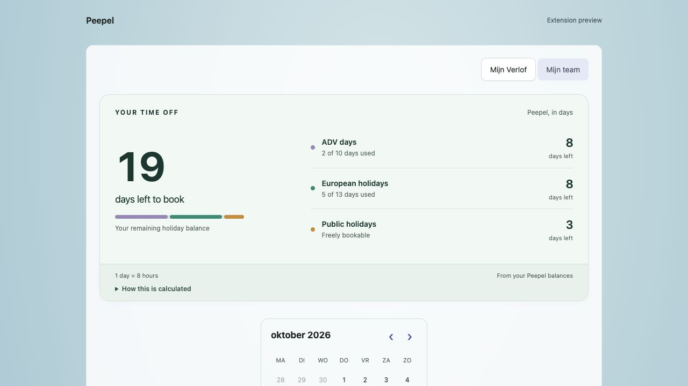

# Better Peepel

A Chrome extension that adds your remaining holidays, in days, above Peepel's calendar.

*Preview uses synthetic data.*

## Install

1. Download this repo via **Code → Download ZIP** and unzip it, or clone it.
2. Open `chrome://extensions` and enable **Developer mode**.
3. Click **Load unpacked** and select the repo's `extension` folder.
4. Open or refresh [Peepel's leave page](https://selfservice.peepel.io/leave).

No build or npm install needed.

## Use

The summary appears automatically in **Mijn Verlof**. It defaults to **8 hours per day**. Change this under **How this is calculated**.

After updating the files, click **Reload** for the extension in `chrome://extensions`, then refresh Peepel.

## How it works

Reads the displayed balances and calculates **remaining days = (allowance − used) ÷ hours per day**. Balances already in days stay as they are. Includes holidays, ADV and freely bookable public holidays; excludes remote work, sickness and types without an allowance.

Updates when the page changes. Runs locally, makes no network requests and stores only your day-length setting. Peepel markup changes may require an extension update.

## Development

`npm ci` → `npm test`. Optional: `npm run preview` serves synthetic sample data at `http://127.0.0.1:4173/leave`; `npm run package` creates an extension ZIP.
